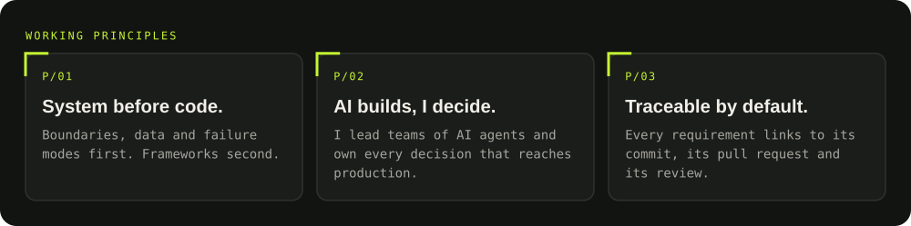
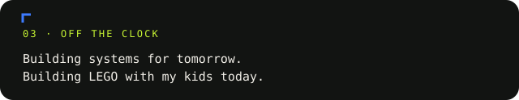

  

<picture>
  <source media="(prefers-reduced-motion: reduce) and (max-width: 600px)" srcset="./assets/hero-mobile-static.svg" />
  <source media="(prefers-reduced-motion: reduce)" srcset="./assets/hero-static.svg" />
  <source media="(max-width: 600px)" srcset="./assets/hero-mobile.svg" />
  
</picture>

  

<picture>
  <source media="(prefers-reduced-motion: reduce) and (max-width: 600px)" srcset="./assets/engineering-ecosystem-mobile-static.svg" />
  <source media="(prefers-reduced-motion: reduce)" srcset="./assets/engineering-ecosystem-static.svg" />
  <source media="(max-width: 600px)" srcset="./assets/engineering-ecosystem-mobile.svg" />
  
</picture>

<picture>
  <source media="(max-width: 600px)" srcset="./assets/principles-mobile.svg" />
  
</picture>

